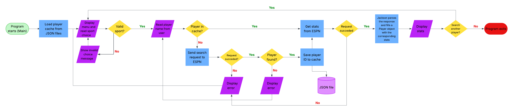

# CS193-Final-Project---Super-Sports-Statistics

Super Sports Statistics provides a free way for you to find the statistics of sports players.

## The Problem

For me, watching sports is more than just my team winning; instead, I love analyzing various statistics and play calls / types. However, many of the sites online that provide in-depth statistics are usually paywalled, and this hinders me from enjoying my hobby as it is much harder to analyze statistics. This is why I want to make a site that allows me to search any player in any sport and provide statistics based off of specific filters.

## How It Works

I am going to build a website that allows users to find any players statistics in any sport supported by the website. They can also filter each players statistics for specific numbers and see if their recent statistics are over or under that number.



## Tech Stack

I am going to be writing in mostly java. I will be using the HttpClient library, the Jackson processing library, JUnit, standard java libraries, and exception imports. For the MVP, I will be storing data in a JSON file. For external sources, I will be using ESPN's public JSON endpoints accessed through HTTPS with HttpClient GET requests.

## Setup

Step-by-step: how does someone who just cloned your repo get it
running?

```bash
git clone https://github.com/you/your-project
cd your-project
./install.sh   # or whatever
```

## Usage

How to actually run the thing, with examples.

```bash
./backup.sh ~/Documents
```

## Roadmap

Features you haven't built yet but plan to (pull these from your
"Schedule" quadrant in the Eisenhower Matrix).

- [ ] Desktop notifications
- [ ] Multi-directory support

## Author

Your name, a link to your GitHub.

